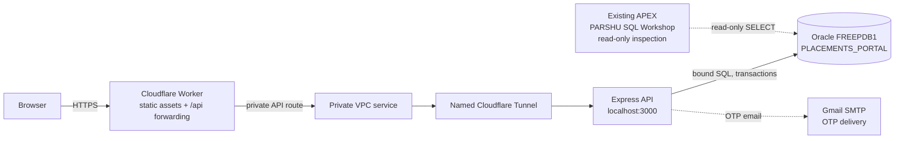

# Amrita Bengaluru Placement Portal


A role-based campus placement portal built for the Amrita Bengaluru DBMS project. The React and TypeScript client talks to an Express API; Oracle Database is the only application database. Gmail carries sign-in codes. The public site is [dbms.sld.parswanadh.dev](https://dbms.sld.parswanadh.dev).

**Source release:** [Parswanadh/DBMS-sld](https://github.com/Parswanadh/DBMS-sld) · **Live demo:** [dbms.sld.parswanadh.dev](https://dbms.sld.parswanadh.dev)

[](deliverables/video/amrita-placement-portal-showcase.mp4)

The image opens the [showcase video](deliverables/video/amrita-placement-portal-showcase.mp4). This poster-and-link format works in GitHub Markdown and links directly to the MP4 file.

## Start here

### Local prerequisites

- Node.js 22 or newer and npm.
- Docker access to the existing `oracle-free` container, with `FREEPDB1` open and the Oracle listener on port 1521.
- For public access: `cloudflared`, Wrangler, the configured Cloudflare account, and this machine's network connection.
- For real email delivery: a Gmail account with 2-Step Verification and a Google App Password.

Create a local environment file from the committed template, then provision the dedicated Oracle schema and initialize its tables and synthetic demo data:

```bash
cp .env.example .env
npm ci
npm run db:provision
npm run db:setup
npm run build
npm run start:background
npm run status
```

The local app is at <http://127.0.0.1:3000>. `db:provision` creates `PLACEMENTS_PORTAL` in `FREEPDB1` with a 100 MB quota and the required schema/session privileges. It generates local secrets; `db:setup` applies additive DDL and idempotent seeds. Neither command resets Oracle or changes APEX. The Node Oracle thin driver does not require an Oracle client installation.

Stop the API with `npm run stop`; check it with `npm run status`. For development, run `npm run dev` and `npm run dev:client` in separate terminals. `npm run start:background` starts the API through a bounded user-level systemd service when available. See [local service setup](#local-services-and-deployment) for persistent setup and tunnel controls.

### Gmail OTP setup

Run `npm run smtp:configure`. It asks for the Gmail sender and App Password with hidden password input and stores settings in the gitignored `.env` file. Do not put secrets in this README, source control, screenshots, or logs. If no initial administrator is set, the configurator uses the sender address as `BOOTSTRAP_ADMIN_EMAIL`. Run `npm run db:setup` afterward, choose **Placement team** on the login screen, and sign in using that reachable address. Students and recruiters use their own reachable email addresses; recruiter accounts require placement-team approval.

Without SMTP credentials, the application reports that email delivery is unavailable. It does not display OTP codes or claim a message was sent. The `@campus.test` seed accounts are synthetic and cannot receive email.

Student email verification confirms access to that mailbox; it does not establish enrollment or institutional affiliation. Recruiter accounts require placement-team approval.

## Product workflows

| Role | Main workflows |
| --- | --- |
| Student | Maintain academic profile, contact numbers, resume, certificates and protected Aadhaar details; find eligible roles; apply and track or withdraw applications; register for hackathons; view placement and internship outcomes. |
| Recruiter | Request account approval; manage company roles and events; review applicants and certificates within the recruiter's company; update application stages; record outcomes and view company reports. |
| Placement team | Review recruiter requests; manage roles and events across companies; inspect student and application records; progress applications, record outcomes, and view department/company reports. |

CTC is stored in annual INR rupees and displayed in LPA; internship compensation is monthly INR. Reports query Oracle records. The seeded records are synthetic demonstration data.

## Architecture and data flow



Cloudflare serves the built client and forwards `/api/*` over its private VPC binding and named tunnel to the local API. Oracle stays on the laptop and its listener is not published. Gmail is only an OTP delivery branch; Oracle stores application records, challenges, resend locks and sessions. APEX is a separate inspection tool, not the React app's runtime.

## Oracle model and DBMS walkthrough

The revised ER model's 10 core entities [DERIVED by counting the mapped entities below] map to `COMPANIES`, `USERS`, `STUDENTS`, `OPPORTUNITIES`, `APPLICATIONS`, `PLACEMENTS`, `INTERNSHIPS`, `HACKATHONS`, `HACKATHON_REGISTRATIONS`, and `CERTIFICATES`. The diagram's `INTERNSHIP_RECORDS` entity is implemented as `INTERNSHIPS`. `DEPARTMENTS` and normalized relations for student phones, opportunity department eligibility and skills complete the 14 business tables [DERIVED: 18 DDL tables minus four auth/file support tables]. `OTP_EMAIL_LOCKS`, `OTP_CHALLENGES`, `SESSIONS`, and `UPLOADS` support authentication and protected files. See [`database/SCHEMA.md`](database/SCHEMA.md) and the DDL in [`database/001_schema.sql`](database/001_schema.sql) for exact columns and constraints.

Primary and foreign keys, uniqueness and check constraints protect core relationships and workflow rules. Repeating phone numbers, eligible departments and required skills have separate relations. The API also stores JSON arrays as compatibility mirrors; those JSON values are denormalized representations, not relational replacements. `PLACEMENTS` keeps an immutable snapshot of job details and eligibility as they stood when the outcome was recorded. Student/company/opportunity display data is joined through the application relationship. Multi-row workflows use Oracle transactions; no business PL/SQL triggers or stored procedures are claimed. The [DBMS walkthrough](docs/team-viva/DBMS-WALKTHROUGH.md) covers joins, aggregates, constraints and transaction examples.

### Inspect through APEX SQL Workshop

The existing APEX workspace and schema are both `PARSHU`. `PARSHU` has read-only `SELECT` access to the 14 business tables [DERIVED: 18 DDL tables minus four auth/file support tables] in `PLACEMENTS_PORTAL`; authentication challenge, lock, session and upload metadata tables are not granted. Open **SQL Workshop → SQL Commands** and run one statement at a time. For example:

```sql
SELECT s.roll_number, u.full_name, u.email, s.cgpa
FROM placements_portal.students s
JOIN placements_portal.users u ON u.id = s.user_id;
```

More safe inspection queries are in [`docs/SQL-WORKSHOP.md`](docs/SQL-WORKSHOP.md). APEX at `http://localhost:8080/ords/apex` is separate from the portal; APEX credentials are not portal login credentials.

## Local services and deployment

The API runs as `campusbridge-api`; the tunnel uses `campusbridge-tunnel`. Runtime services are bounded and restart on failure. Logs are written to `logs/server.log` and `logs/tunnel.log`. The services require the laptop, network and Oracle to remain available.

To install persistent user services, first validate the rendered units, then install them:

```bash
npm run services:check
npm run services:install
npm run status
npm run tunnel:status
```

Installation enables the API and tunnel units but does not start, stop, or restart them. Use `npm run start:background`, `npm run stop`, `npm run tunnel:start`, and `npm run tunnel:stop` to control them. The service scripts use `systemctl --user` for installed units and a bounded transient systemd unit when no persistent definition is installed.

Cloudflare deployment is configured in [`cloudflare/wrangler.jsonc`](cloudflare/wrangler.jsonc) and `cloudflare/deployment.json`. After configuring Wrangler credentials and bringing up Oracle and the API, deploy with:

```bash
wrangler whoami
npm run tunnel:start
npm run start:background
npm run build
npm run deploy:cloudflare
curl --fail https://dbms.sld.parswanadh.dev/api/health
```

The deployment script first checks local API/database health. It passes `ORIGIN_AUTH_TOKEN` to `wrangler secret put` through stdin, then deploys the Worker; it does not print or place that value in process arguments. Never publish a secret value. A `503` from the public API commonly means the local API, Oracle, tunnel, or Cloudflare private service is unavailable; check `npm run status`, `npm run tunnel:status`, the two logs, and local `/api/health` before redeploying. A healthy local Oracle-backed API with a public `503` points to the forwarding/tunnel path rather than the React client.

## Final verification

The public-source QA follow-up ran from 2026-11-10 18:58–19:02 UTC and is recorded on 2026-11-11. It used the published checkout at base commit `3c4308f5bbfa64aa1f11a640e25e99dd0377dbcf` with frozen Login/Profile privacy-copy follow-up edits, which were uncommitted during the run. The tested source hashes and exact command scope are in the [follow-up report](tools/egm/public-release/public-qa-followup.md) and [public landing measurements](docs/showcase/public-device-results.json); this QA state is not a claim that those edits are already on `main`.

| Area | Verified result | Evidence and limits |
| --- | --- | --- |
| Earlier app gate | Typecheck and production build passed. Oracle integration: 87 checks passed [MEASURED]. Branded email/MIME preview: 14 checks passed [MEASURED]. | Recorded in the [earlier QA report](.superpowers/sdd/public-release/qa-publish-report.md), before the public Login/Profile copy follow-up. The latest public-source follow-up reran the build and mobile gates, not Oracle integration. Test mail used in-process JSON capture; no external email was sent. |
| Mobile workflows | Typecheck and production build passed. Brand/landing: 29 checks [MEASURED]. Shell/navigation: 35 checks [MEASURED]. Three-role functional browser: 43 checks [MEASURED]. | Five mobile gates are recorded in the [QA report](.superpowers/sdd/public-release/qa-publish-report.md). Browser automation exercised student, recruiter and placement-team workflows; this is not exhaustive coverage or physical-device certification. |
| Public landing and Login privacy dialog | 20 checks passed [MEASURED]: 19 landing layout/motion checks plus one Login privacy-dialog assertion. The landing checks cover 12 CSS viewport widths from 320 to 1920 px [MEASURED], 200% computed-font-size emulation at four widths [MEASURED], and reduced-motion behavior. | [Public landing measurements](docs/showcase/public-device-results.json) records the check list, rectangles, tested source hashes and screenshot paths. The profile copy was built and included in the source hash; the targeted exact-copy assertion applied to the Login dialog. Text-size emulation is not browser chrome zoom, and browser emulation does not certify physical devices. |

The results apply to the frozen source hashes recorded in the reports; they are not performance benchmarks or a claim of real placement outcomes. The public service still depends on this laptop, Oracle and its network/tunnel path. QA did not send real email or certify physical devices.

## Presentation and video

The editable PowerPoint and matching PDF are available: [download the PPTX](deliverables/presentation/amrita-placement-portal-showcase.pptx) and [download the PDF](deliverables/presentation/amrita-placement-portal-showcase.pdf). The [presentation preview contact sheet](deliverables/presentation/preview/contact-sheet.png) shows the slides. See [`deliverables/presentation/content.json`](deliverables/presentation/content.json) for editable slide content and [`docs/showcase/storyboard.md`](docs/showcase/storyboard.md) for evidence boundaries. Presenter scripts: [Balcha](docs/presentation-speaking-scripts/01-balcha-venkata-parswanadh.md), [Balaji](docs/presentation-speaking-scripts/02-balaji-rayudu.md), [Bhavana](docs/presentation-speaking-scripts/03-bhavana-malladi.md), [Abhiram](docs/presentation-speaking-scripts/04-abhiram-support-demo.md), and the [timed master handoff](docs/presentation-speaking-scripts/MASTER-HANDOFF.md).

The HyperFrames video is ready: [download the MP4](deliverables/video/amrita-placement-portal-showcase.mp4), [view the poster](deliverables/video/amrita-placement-portal-showcase-poster.jpg), or [open the render contact sheet](deliverables/video/render-contact-sheet.jpg). See the [video production report](deliverables/video/README.md) for commands and media provenance. Share copy and required music/SFX attribution are in [`deliverables/video/share-copy.txt`](deliverables/video/share-copy.txt). The local pinned workflow uses no model API key.

## EGM document review

The **Nov 9 mobile showcase** had two fresh-context reviews using a local, adapted Elephant-Goldfish document-review workflow; see [`tools/egm/review-record.md`](tools/egm/review-record.md) and [`tools/egm/reviews/`](tools/egm/reviews/). The current public-release pass also has a read-only independent source/security/publication review in [the Sol review report](.superpowers/sdd/public-release/sol-initial-review.md) and [public-readiness findings](docs/showcase/public-readiness-findings.md). These are document/source reviews, not a trained placement model, exhaustive security audit, or portal runtime feature. The upstream EGM plugin was not installed or invoked. No reviewer input should contain real student data, credentials, OTPs or uploads. See [`tools/egm/README.md`](tools/egm/README.md) for adaptation scope and provenance.

## Re-run checks after changes

```bash
npm run typecheck
npm run build
npm run test:integration
npm run test:browser
npm run test:brand-email
npm run test:brand-browser
```

Integration tests require the dedicated Oracle schema and use unique test rows with cleanup. In test mode only, OTP mail is captured in memory; no real email is sent. Browser checks use local services and installed Chrome. The commands above are available for re-running relevant checks after changes; the latest measured results are in the final verification section and source reports.

## Project team — Batch 3

| Member | Agreed responsibility for the viva |
| --- | --- |
| **Balcha Venkata Parswanadh — BL.EN.U4EAC24012** | Major: core architecture, backend integration, login and Gmail SMTP. |
| **Balaji Rayudu S — BL.EN.U4EAC24011** | Major: frontend/UI and shared Oracle schema, SQL and constraints for users, students, phone numbers, certificates and authentication relations. |
| **Bhavana Malladi — BL.EN.U4EAC24014** | Major: shared Oracle schema, SQL and constraints for companies, opportunities, applications, outcomes, hackathons, eligibility, reports and transactions. |
| **Balusu Naga Sri Abhiram — BL.EN.U4EAC24013** | Support: synthetic sample data, documentation and demo QA. |

This is the agreed responsibility and viva split, not a statement of commit authorship or effort percentages. See [team contributions](docs/team-viva/TEAM-CONTRIBUTIONS.md), the [DBMS walkthrough](docs/team-viva/DBMS-WALKTHROUGH.md), and the [demo checklist](docs/team-viva/DEMO-CHECKLIST.md).

## Repository map

- `client/` — React and TypeScript user interface and supplied brand/media assets.
- `server/` — Express API, authentication, mail and Oracle access.
- `database/` — Oracle schema, additive migrations, seed data and schema reference.
- `tests/`, `scripts/` — integration/browser checks and provisioning, service, deployment and review-loop tools.
- `docs/` — API contract, SQL workshop, team viva and showcase guidance.
- `tools/egm/` — pinned upstream review references and local review bundle.
- `deliverables/`, `brag-output/` — editable presentation/video source and release outputs as generated.
